 <div align="center">

# 🤖 WhatsApp Personal AI Bot

### Your Personal AI Assistant for WhatsApp

A smart AI-powered WhatsApp assistant with a modern web dashboard to manage chats, contacts, notifications, WhatsApp connections, and AI settings.

<p>
  <a href="https://nitesh-personal-bot.onrender.com">🌐 Live Demo</a> •
  <a href="https://github.com/nitesh933438/WhatsApp-Personal-AI-Bot-Demo">📂 Repository</a> •
  <a href="https://github.com/nitesh933438">👨‍💻 Developer</a>
</p>


</div>

---

# 🎬 Live Demo

<p align="center">
  <a href="https://nitesh-personal-bot.onrender.com">
    
  </a>
</p>

<p align="center">
  <b>Explore the dashboard and application workflow.</b>
</p>

🌐 **Live Website:** https://nitesh-personal-bot.onrender.com

---

# 📸 Application Screenshots

## 🖥️ Desktop Screenshots

<table>
<tr>
<td align="center"><b>🏠 Home Dashboard</b><br><br>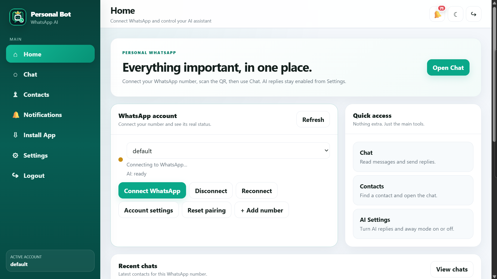</td>
<td align="center"><b>💬 Chat Management</b><br><br>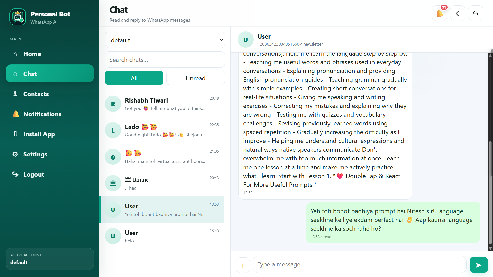</td>
</tr>
<tr>
<td align="center"><b>👥 Contacts</b><br><br>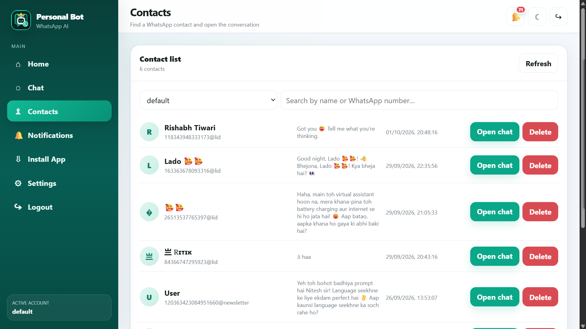</td>
<td align="center"><b>🔔 Notifications</b><br><br>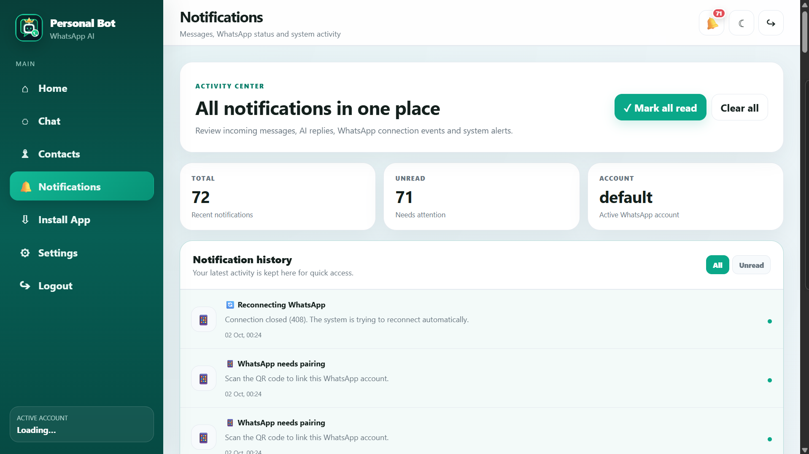</td>
</tr>
<tr>
<td align="center"><b>⚙️ Settings</b><br><br>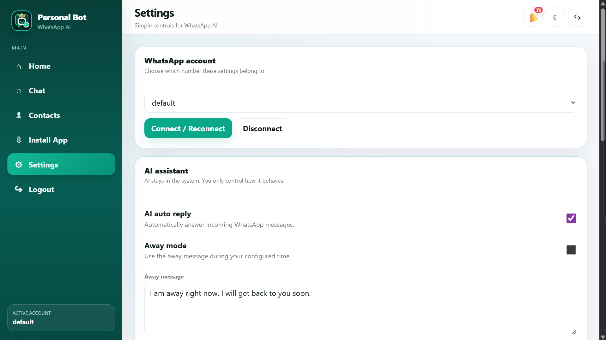</td>
<td align="center"><b>🔐 Login</b><br><br>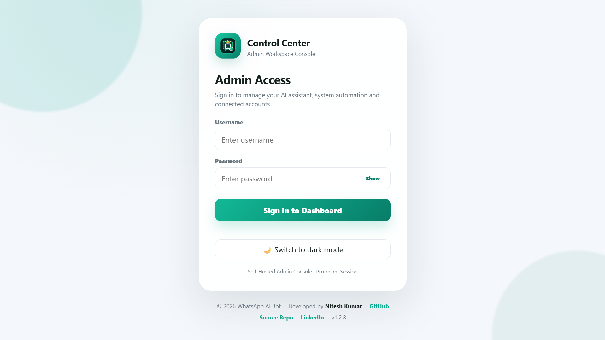</td>
</tr>
</table>

## 📱 Mobile Screenshots

<table>
<tr>
<td align="center"><b>🏠 Mobile Home</b><br><br>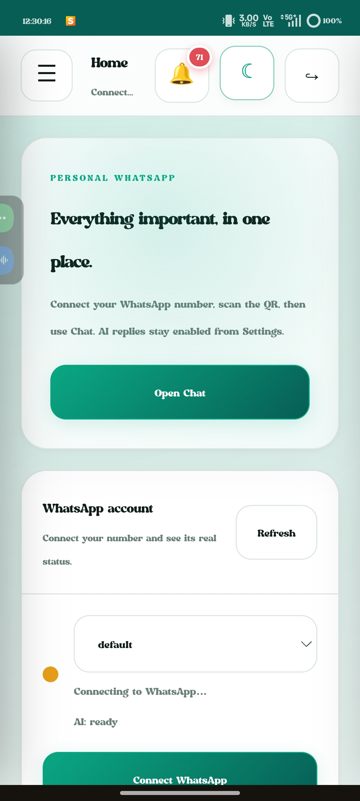</td>
<td align="center"><b>💬 Mobile Chat</b><br><br>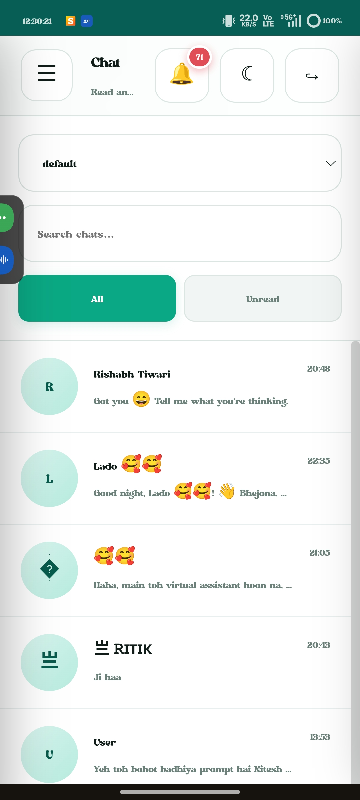</td>
</tr>
<tr>
<td align="center"><b>👥 Mobile Contacts</b><br><br>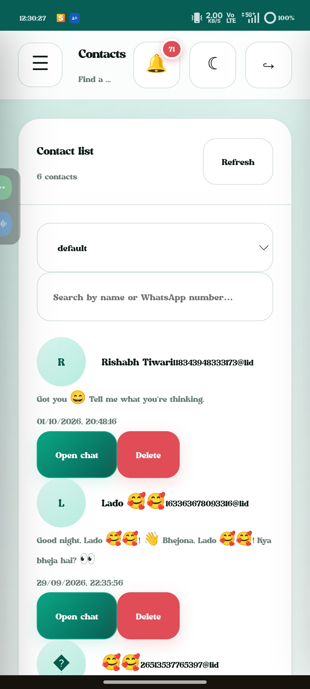</td>
<td align="center"><b>🔔 Mobile Notifications</b><br><br>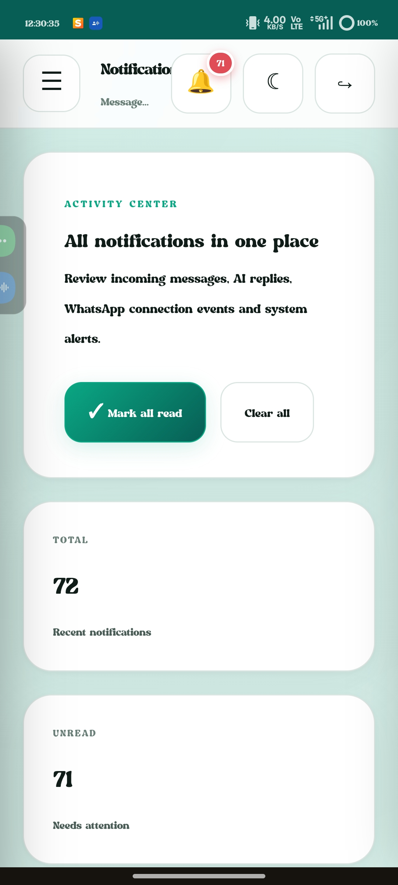</td>
</tr>
<tr>
<td align="center"><b>⚙️ Mobile Settings</b><br><br>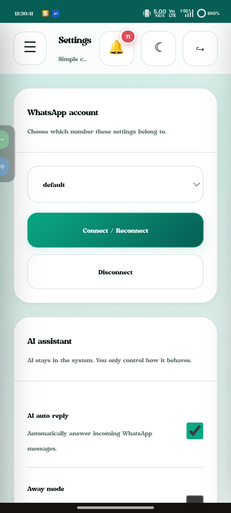</td>
<td align="center"><b>🔐 Mobile Login</b><br><br>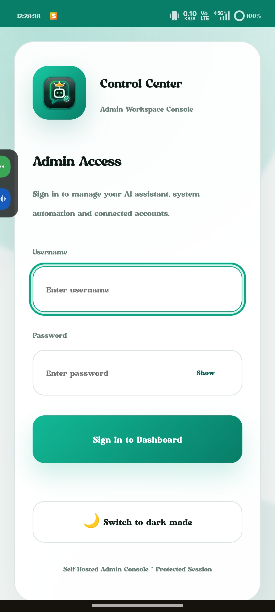</td>
</tr>
</table>

---

# ✨ Features

* 🤖 **AI-Powered Assistant** — AI integration for WhatsApp conversations.
* 💬 **Chat Management** — View and manage conversations through the dashboard.
* 📱 **WhatsApp Connection** — Connect and manage WhatsApp sessions.
* 👥 **Contact Management** — Access and manage contacts.
* 🔔 **Notifications** — Notification management interface.
* ⚙️ **AI Settings** — Configure AI providers and application settings.
* 🔄 **Real-Time Updates** — Socket.IO integration.
* 📲 **Responsive Design** — Desktop and mobile-friendly interface.
* 📦 **PWA Support** — Installable web application.
* 🔐 **Admin Authentication** — Protected dashboard access.
* 🐳 **Docker Support** — Container-based deployment configuration.
* ☁️ **Deployment Configuration** — Includes Render configuration.

*Feature availability depends on the application's configuration and connected services.*

---

# 🛠️ Technology Stack

| Technology    | Purpose                       |
| ------------- | ----------------------------- |
| Node.js       | Backend runtime               |
| Express.js    | Backend framework             |
| Baileys       | WhatsApp connectivity         |
| Google Gemini | AI integration                |
| OpenAI        | Optional AI provider          |
| Ollama        | Optional local AI provider    |
| MongoDB       | Database                      |
| Mongoose      | Database modeling             |
| Socket.IO     | Real-time communication       |
| HTML          | Web page structure            |
| CSS           | Styling and responsive layout |
| JavaScript    | Frontend functionality        |
| PWA           | Installable web application   |
| Docker        | Containerization              |
| Render        | Hosting and deployment        |

---

# 🚀 Installation & Setup

## Prerequisites

Make sure you have the following installed:

* Node.js 20 or later
* npm
* MongoDB database
* API key for your chosen AI provider

## 1. Clone the Repository

```bash
git clone https://github.com/nitesh933438/WhatsApp-Personal-AI-Bot-Demo.git
```

```bash
cd WhatsApp-Personal-AI-Bot-Demo
```

## 2. Install Dependencies

```bash
npm install
```

## 3. Configure Environment Variables

Create a `.env` file in the project root.

```env
PORT=3000

MONGO_URI=your_mongodb_connection_string

ADMIN_USER=admin
ADMIN_PASSWORD=your_secure_password

JWT_SECRET=your_jwt_secret
SESSION_SECRET=your_session_secret

GEMINI_API_KEY=your_gemini_api_key
GEMINI_MODEL=your_gemini_model

GEMINI_FALLBACK_MODELS=

AI_PROVIDER_ORDER=gemini,openai,ollama

OPENAI_API_KEY=

OLLAMA_ENABLED=false

WHATSAPP_SESSION_PATH=./sessions
WHATSAPP_AUTO_START=false
```

Replace the example values with your own configuration. Never share your API keys or passwords.

## 4. Start the Application

```bash
npm start
```

Open the local application URL using the configured port.

---

# 🧠 AI Provider Configuration

The project supports configurable AI providers.

| Provider               | Environment Variable     |
| ---------------------- | ------------------------ |
| Google Gemini          | `GEMINI_API_KEY`         |
| Gemini Model           | `GEMINI_MODEL`           |
| Gemini Fallback Models | `GEMINI_FALLBACK_MODELS` |
| OpenAI                 | `OPENAI_API_KEY`         |
| Ollama                 | `OLLAMA_ENABLED`         |
| Provider Priority      | `AI_PROVIDER_ORDER`      |

Configure the providers and credentials you intend to use.

---

# 📲 WhatsApp Connection

1. Start the application.
2. Open the web dashboard.
3. Navigate to the WhatsApp account or connection section.
4. Start the connection process.
5. Follow the pairing instructions displayed by the application.
6. Keep your WhatsApp session data secure.

The connection process depends on your WhatsApp account and deployment configuration.

---

# ☁️ Deployment

The project includes deployment-related configuration, including a `Dockerfile` and `render.yaml`.

### Deployment Checklist

* Configure environment variables.
* Set up the MongoDB connection.
* Configure admin credentials.
* Add the required AI provider API keys.
* Configure secure application secrets.
* Set up persistent storage for WhatsApp session data if needed.
* Deploy the application.
* Review application logs and verify the deployed services.

**Live Application:**
https://nitesh-personal-bot.onrender.com

---

# 🩺 Health Check

The project includes health-check support for application monitoring.

Refer to the server routes and deployment configuration in the repository for the exact health-check endpoint.

---

# 📁 Project Structure

```text
WhatsApp-Personal-AI-Bot/
│
├── public/
├── src/
│   └── assets/
│       └── images/
│
├── services/
├── scripts/
│
├── docs/
│   ├── demo.gif
│   └── screenshots/
│       ├── desktop-01.png
│       ├── desktop-02.png
│       ├── desktop-03.png
│       ├── desktop-04.png
│       ├── desktop-05.png
│       ├── desktop-06.png
│       ├── mobile-01.jpg
│       ├── mobile-02.jpg
│       ├── mobile-03.jpg
│       ├── mobile-04.jpg
│       ├── mobile-05.jpg
│       └── mobile-06.jpg
│
├── Dockerfile
├── render.yaml
├── package.json
└── README.md
```

---

# 🔐 Security

* Never commit your `.env` file.
* Use strong admin credentials.
* Keep API keys and tokens private.
* Use secure JWT and session secrets.
* Protect WhatsApp session data.
* Avoid sharing private connection information.

---

# 👨‍💻 Developer

<div align="center">


# Nitesh Kumar

### Full Stack Developer

Building modern web applications, AI-powered tools, and practical software solutions.

<p>
<a href="https://github.com/nitesh933438">

</a>
<a href="https://www.linkedin.com/in/nitesh933438/">

</a>
</p>

</div>

## 🔗 Developer Profiles

| Platform              | Link                                                                                           |
| --------------------- | ---------------------------------------------------------------------------------------------- |
| 👨‍💻 GitHub Profile  | [Nitesh Kumar](https://github.com/nitesh933438)                                                |
| 💼 LinkedIn Profile   | [Nitesh Kumar](https://www.linkedin.com/in/nitesh933438/)                                      |
| 📦 Project Repository | [WhatsApp Personal AI Bot Demo](https://github.com/nitesh933438/WhatsApp-Personal-AI-Bot-Demo) |
| 🌐 Live Project       | [Open Live Demo](https://nitesh-personal-bot.onrender.com)                                     |

---

# 📄 License

This project is licensed under the **ISC License**. See the `LICENSE` file for details.

---

<div align="center">

### ⭐ If you like this project, consider giving it a star!

**Made with ❤️ by [Nitesh Kumar](https://github.com/nitesh933438)**

</div>
